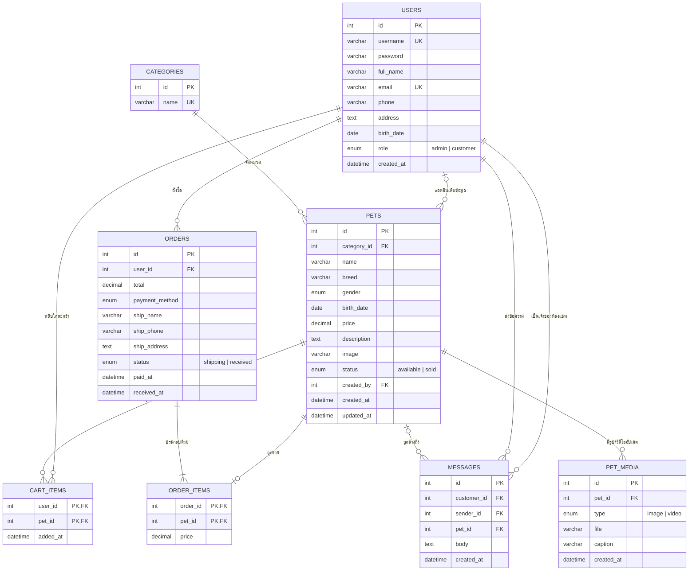

# PawPaws – ER Diagram & Mapping

## 1. ER Diagram

## 2. Mapping เป็นตาราง (Relational Schema)

- **users** (<u>id</u>, username, password, full_name, email, phone, address, birth_date, role, created_at)
- **categories** (<u>id</u>, name)
- **pets** (<u>id</u>, *category_id*→categories, name, breed, gender, birth_date, price, description, image, status, *created_by*→users, created_at, updated_at)
- **pet_media** (<u>id</u>, *pet_id*→pets, type, file, caption, created_at)
- **cart_items** (<u>*user_id*</u>→users, <u>*pet_id*</u>→pets, added_at)
- **orders** (<u>id</u>, *user_id*→users, total, payment_method, ship_name, ship_phone, ship_address, status, paid_at, received_at)
- **order_items** (<u>*order_id*</u>→orders, <u>*pet_id*</u>→pets, price)
- **messages** (<u>id</u>, *customer_id*→users, *sender_id*→users, *pet_id*→pets, body, created_at)

(ขีดเส้นใต้ = Primary Key, ตัวเอียง = Foreign Key)

## 3. Data Dictionary

### users – สมาชิก (แอดมิน/ลูกค้า)
| Field | Type | Key | Description |
|---|---|---|---|
| id | INT AUTO_INCREMENT | PK | รหัสสมาชิก |
| username | VARCHAR(50) | UNIQUE | ชื่อผู้ใช้ |
| password | VARCHAR(255) | | รหัสผ่าน (bcrypt hash) |
| full_name | VARCHAR(100) | | ชื่อ-นามสกุล |
| email | VARCHAR(100) | UNIQUE | อีเมล |
| phone | VARCHAR(20) | | เบอร์โทร |
| address | TEXT | | ที่อยู่ |
| birth_date | DATE | | วันเกิด (ตรวจอายุ 18+) |
| role | ENUM('admin','customer') | | ประเภทบัญชี |
| created_at | DATETIME | | วันที่สมัคร |

### categories – ประเภทสัตว์เลี้ยง
| Field | Type | Key | Description |
|---|---|---|---|
| id | INT AUTO_INCREMENT | PK | รหัสประเภท |
| name | VARCHAR(50) | UNIQUE | ชื่อประเภท |

### pets – โปรไฟล์สัตว์เลี้ยง
| Field | Type | Key | Description |
|---|---|---|---|
| id | INT AUTO_INCREMENT | PK | รหัสสัตว์เลี้ยง |
| category_id | INT | FK → categories.id | ประเภท |
| name | VARCHAR(100) | | ชื่อน้อง |
| breed | VARCHAR(100) | | สายพันธุ์ |
| gender | ENUM('male','female') | | เพศ |
| birth_date | DATE | | วันเกิด (คำนวณอายุอัตโนมัติ) |
| price | DECIMAL(10,2) | | ราคา |
| description | TEXT | | รายละเอียด |
| image | VARCHAR(255) | | รูปหลัก |
| status | ENUM('available','sold') | | สถานะ (sold = ได้บ้านแล้ว) |
| created_by | INT | FK → users.id | แอดมินผู้เพิ่ม |
| created_at / updated_at | DATETIME | | วันที่เพิ่ม/แก้ไข |

### pet_media – รูป/วิดีโออัปเดตตัวจริง
| Field | Type | Key | Description |
|---|---|---|---|
| id | INT AUTO_INCREMENT | PK | รหัสไฟล์ |
| pet_id | INT | FK → pets.id | สัตว์เลี้ยง |
| type | ENUM('image','video') | | ชนิดไฟล์ |
| file | VARCHAR(255) | | ชื่อไฟล์ |
| caption | VARCHAR(255) | | คำอธิบาย |
| created_at | DATETIME | | วันที่อัปเดต |

### cart_items – ตะกร้าสินค้า
| Field | Type | Key | Description |
|---|---|---|---|
| user_id | INT | PK, FK → users.id | ลูกค้า |
| pet_id | INT | PK, FK → pets.id | สัตว์เลี้ยง |
| added_at | DATETIME | | วันที่เพิ่ม |

### orders – คำสั่งซื้อ / การชำระเงิน / ติดตามการจัดส่ง
| Field | Type | Key | Description |
|---|---|---|---|
| id | INT AUTO_INCREMENT | PK | เลขที่คำสั่งซื้อ |
| user_id | INT | FK → users.id | ลูกค้า |
| total | DECIMAL(10,2) | | ยอดรวม |
| payment_method | ENUM('transfer','promptpay','card','cod') | | วิธีชำระเงิน |
| ship_name / ship_phone / ship_address | VARCHAR / TEXT | | ข้อมูลผู้รับ |
| status | ENUM('shipping','received') | | กำลังจัดส่ง / รับน้องแล้ว |
| paid_at | DATETIME | | เวลาชำระเงิน (ใช้คำนวณสถานะ 5/10/15 วินาที) |
| received_at | DATETIME | | เวลาที่ลูกค้ากดยืนยันรับน้อง |

### order_items – รายการในคำสั่งซื้อ
| Field | Type | Key | Description |
|---|---|---|---|
| order_id | INT | PK, FK → orders.id | คำสั่งซื้อ |
| pet_id | INT | PK, FK → pets.id | สัตว์เลี้ยง |
| price | DECIMAL(10,2) | | ราคา ณ วันที่ซื้อ |

### messages – แชทระหว่างลูกค้ากับแอดมิน
| Field | Type | Key | Description |
|---|---|---|---|
| id | INT AUTO_INCREMENT | PK | รหัสข้อความ |
| customer_id | INT | FK → users.id | ห้องแชทของลูกค้า |
| sender_id | INT | FK → users.id | ผู้ส่ง |
| pet_id | INT NULL | FK → pets.id | น้องที่สอบถาม |
| body | TEXT | | ข้อความ |
| created_at | DATETIME | | เวลาส่ง |
